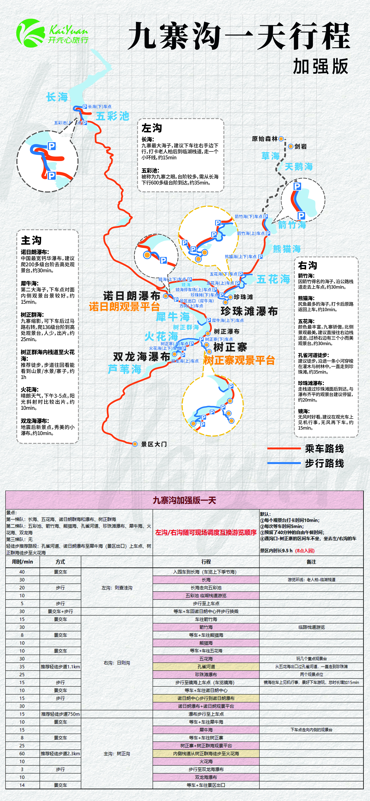

# 九寨沟一天行程 · 加强版

> 来源：图片版《九寨沟一天行程 · 加强版》（`九寨沟一天加强版.jpg`）。本文件为文本转写版，原图保留在仓库根目录，便于对照与后续修订。

## 行前信息

### 景点梯队
- 第一梯队：长海、五花海、诺日朗群海和瀑布、树正群海
- 第二梯队：五彩池、箭竹海、熊猫海、孔雀河道、珍珠滩瀑布、犀牛海、火花海、双龙海
- 第三梯队：无

### 默认设定

1. 每个观景台打卡时间10分钟；
2. 每次等车时间5分钟；
3. 预留了40分钟的自由午餐时间；
4. 遇沟口-树正寨的区间车不坐，坐去左/右沟的车。

景区内时长9.5小时（8点入园）。

### 调度说明

- 左沟/右沟随可现场调度互换游览顺序。

## 路线与看点

### 路线示意（文字版）
- 图例：乘车路线（橙红色实线）、步行路线（蓝色实线）。
- 乘车路线：车点依次为 景区大门 → 双龙海（上）车点 → 火花海（上下）车点 → 树正寨（上）车点 / 树正寨（下）车点 → 犀牛海（上下）车点 → 诺日朗中心；在诺日朗中心换乘后分两路：左沟至长海（下）车点（返程在五彩池（上）车点上车），右沟经镜海停车场（上）车点、珍珠滩（下）车点、五花海（下）车点、五花海（上）车点、熊猫海（上下）车点，至箭竹海（下）车点、箭竹海（上）车点。原始森林、剑岩位于图上方，以虚线相连，不在本行程的乘车路线上。
- 步行路线：长海小环线（长海（下）车点—五彩池（上）车点）、箭竹海栈道、五花海环湖栈道、孔雀河道—珍珠滩—镜海上车点栈道、诺日朗中心—诺日朗瀑布—上车点栈道、树正群海内侧栈道—火花海—双龙海瀑布。

### 左沟（则查洼沟）
- **长海**：九寨最大海子，建议下车往右手边下行，打卡老人柏后到临湖栈道，走一个小环线，约15分钟
- **五彩池**：被称为九寨之眼。台阶较多，需从长海下行600多级台阶到达，约35分钟。

### 右沟（日则沟）
- **箭竹海**：因箭竹得名的海子，沿公路栈道走去上车点，约30分钟。
- **熊猫海**：尻鱼最多的海子，打卡后原路返回上车，约10分钟。
- **五花海**：颜色最丰富，九寨骄傲，北侧景观最美，建议直接往右边栈道走，过桥右边有三个小而美观景台。约30分钟。
- **孔雀河道徒步**：建议徒步，沿途一条小河穿梭在灌木与树林中，一直走到珍珠滩，约35分钟。
- **珍珠滩瀑布**：走栈道过珍珠滩面后到达，与瀑布齐平的观景台建议停留，约20分钟。
- **镜海**：无风时好看，建议在观光车上见机行事，无风再下车。约15分钟。

### 主沟（树正沟）
- **诺日朗瀑布**：中国最宽钙华瀑布，建议爬200多级台阶去高处观景台，约30分钟。
- **犀牛海**：第二大海子，下车点对面内侧观景台景较好。约15分钟。
- **树正群海**：九寨缩影，可下车后过马路右转，爬136级台阶到高处观景台，人少，出片。约25分钟。
- **树正群海内栈道至火花海**：推荐徒步，步道往回看能看到山景/水景/寨子，约1小时
- **火花海**：晴朗天气，下午3-5点，阳光斜射时比较出片。约10分钟。
- **双龙海瀑布**：地震后新景点，秀美的小瀑布。约10分钟。

## 行程表

| 区段 | 用时/分钟 | 方式 | 行程 | 备注 |
|---|---|---|---|---|
| 左沟：则查洼沟 | 40 | 景交车 | 入园车到长海（车览上下季节海） | — |
| 左沟：则查洼沟 | 30 | — | 长海 | 游览环线：老人柏-临湖栈道 |
| 左沟：则查洼沟 | 20 | 步行 | 长海走向五彩池 | — |
| 左沟：则查洼沟 | 10 | — | 五彩池 临湖栈道游览 | — |
| 左沟：则查洼沟 | 5 | 步行 | 步行至上车点 | — |
| — | 30 | 景交车+步行 | 等车+车回诺日朗中心并步行换乘 | — |
| 右沟：日则沟 | 15 | 景交车 | 车往箭竹海 | — |
| 右沟：日则沟 | 30 | — | 箭竹海 | 临路栈道游览 |
| 右沟：日则沟 | 8 | 景交车 | 等车+车往熊猫海 | — |
| 右沟：日则沟 | 10 | — | 熊猫海 | — |
| 右沟：日则沟 | 10 | 景交车 | 等车+车往五花海 | — |
| 右沟：日则沟 | 30 | — | 五花海 | 玩几个重点观景台 |
| 右沟：日则沟 | 35 | 推荐轻徒步步道1.1km | 孔雀河道 | 从五花海出口过孔雀河道，一直走到珍珠滩 |
| 右沟：日则沟 | 25 | — | 珍珠滩瀑布 | 两个观景点位 |
| 右沟：日则沟 | 15 | 步行 | 步行至镜海上车点（车览镜海） | 镜海在车上见机行事，最好下车游玩，总时长增加15min |
| 右沟：日则沟 | 10 | 景交车 | 等车+车往诺日朗中心 | — |
| 右沟：日则沟 | 15 | 步行 | 诺日朗中心步行到诺日朗瀑布 | — |
| 右沟：日则沟 | 30 | — | 诺日朗瀑布+诺日朗观景平台 | — |
| — | 15 | 推荐轻徒步步道750m | 瀑布步行至上车点 | — |
| 主沟：树正沟 | 10 | 景交车 | 等车+车往犀牛海 | — |
| 主沟：树正沟 | 15 | — | 犀牛海 | 下车点走向内侧的观景台 |
| 主沟：树正沟 | 8 | 景交车 | 等车+车往树正寨 | — |
| 主沟：树正沟 | 25 | — | 树正寨+树正群海观景平台 | — |
| 主沟：树正沟 | 60 | 推荐轻徒步步道2.3km | 内侧栈道从树正群海徒步至火花海 | — |
| 主沟：树正沟 | 10 | — | 火花海 | — |
| 主沟：树正沟 | 3 | 步行 | 步行至双龙海瀑布 | — |
| 主沟：树正沟 | 10 | — | 双龙海瀑布 | — |
| 主沟：树正沟 | 14 | 景交车 | 等车+车往景区出口 | — |

## 轻徒步推荐

- 孔雀河道
- 诺日朗瀑布至犀牛海（景区出口）上车点
- 树正群海徒步至火花海

## 转写存疑

- 熊猫海条目原图写作「尻鱼最多的海子」（首字字形为「尸+九」），照录；疑为原图笔误，后续修订时可据景区资料确认。
- 红字原文为「左沟/右沟随可现场调度互换游览顺序」（语序如此），照录。
