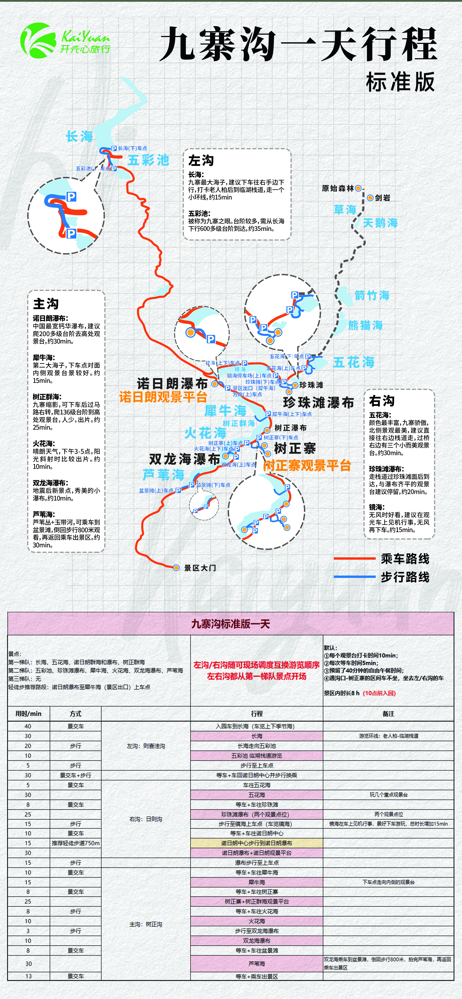

# 九寨沟一天行程 · 标准版

> 来源：图片版《九寨沟一天行程 · 标准版》（`九寨沟一天标准版.jpg`）。本文件为文本转写版，原图保留在仓库根目录，便于对照与后续修订。

## 行前信息

### 景点梯队

- 第一梯队：长海、五花海、诺日朗群海和瀑布、树正群海
- 第二梯队：五彩池、珍珠滩瀑布、犀牛海、火花海、双龙海瀑布、芦苇海
- 第三梯队：无

### 默认设定

1. 每个观景台打卡时间10分钟；
2. 每次等车时间5分钟；
3. 预留了40分钟的自由午餐时间；
4. 遇沟口-树正寨的区间车不坐，坐去左/右沟的车。

景区内时长8小时（10点前入园）。

### 调度说明

- 左沟/右沟随可现场调度互换游览顺序。
- 左右沟都从第一梯队景点开场。

## 路线与看点

### 路线示意（文字版）

- 乘车路线（橙红实线）：按行程表依次为 入园车到长海 → 车回诺日朗中心并步行换乘 → 车往五花海 → 车往珍珠滩 → 车往诺日朗中心 → 车往犀牛海 → 车往树正寨 → 车往火花海 → 车往盆景滩 → 乘车出景区；图上车点依次为 长海(下)车点、五彩池(上)车点、五花海(下)车点、五花海(上)车点、珍珠滩(下)车点、镜海停车场(上)车点、镜海(上下)车点、景区出口（犀牛海）方向(上)车点、犀牛海(上下)车点、树正寨(上)车点、树正寨(下)车点、火花海(上下)车点、双龙海(上)车点、盆景滩(下)车点、盆景滩(上)车点。
- 步行路线（蓝线）：长海走向五彩池、五彩池临湖栈道游览、步行至上车点、步行至镜海上车点（车览镜海）、诺日朗中心步行到诺日朗瀑布（推荐轻徒步步道750m）、瀑布步行至上车点、步行至双龙海瀑布、盆景滩倒回步行800米观看芦苇海。
- 图例：乘车路线（橙红实线）、步行路线（蓝线）。
- 其他标注：原始森林—剑岩—草海—天鹅海—箭竹海—熊猫海一侧以虚线标注，原图未见图例说明。

### 左沟（则查洼沟）

- **长海**：九寨最大海子，建议下车往右手边下行，打卡老人柏后到临湖栈道，走一个小环线，约15分钟。
- **五彩池**：被称为九寨之眼。台阶较多，需从长海下行600多级台阶到达，约35分钟。

### 右沟（日则沟）

- **五花海**：颜色最丰富，九寨骄傲，北侧景观最美，建议直接往右边栈道走，过桥右边有三个小而美观景台。约30分钟。
- **珍珠滩瀑布**：走栈道过珍珠滩面后到达，与瀑布齐平的观景台建议停留，约20分钟。
- **镜海**：无风时好看，建议在观光车上见机行事，无风再下车。约15分钟。

### 主沟（树正沟）

- **诺日朗瀑布**：中国最宽钙华瀑布，建议爬200多级台阶去高处观景台，约30分钟。
- **犀牛海**：第二大海子，下车点对面内侧观景台景较好。约15分钟。
- **树正群海**：九寨缩影，可下车后过马路右转，爬136级台阶到高处观景台，人少，出片。约25分钟。
- **火花海**：晴朗天气，下午3-5点，阳光斜射时比较出片。约10分钟。
- **双龙海瀑布**：地震后新景点，秀美的小瀑布。约10分钟。
- **芦苇海**：芦苇丛+玉带河，可乘车到盆景滩，倒回步行800米观看，再返回乘车出景区。约30分钟。

## 行程表

| 区段 | 用时/分钟 | 方式 | 行程 | 备注 |
|---|---|---|---|---|
| 左沟：则查洼沟 | 40 | 景交车 | 入园车到长海（车览上下季节海） | — |
| 左沟：则查洼沟 | 30 | — | 长海 | 游览环线：老人柏-临湖栈道 |
| 左沟：则查洼沟 | 20 | 步行 | 长海走向五彩池 | — |
| 左沟：则查洼沟 | 10 | — | 五彩池 临湖栈道游览 | — |
| 左沟：则查洼沟 | 5 | 步行 | 步行至上车点 | — |
| — | 30 | 景交车+步行 | 等车+车回诺日朗中心并步行换乘 | — |
| 右沟：日则沟 | 5 | 景交车 | 车往五花海 | — |
| 右沟：日则沟 | 30 | — | 五花海 | 玩几个重点观景台 |
| 右沟：日则沟 | 8 | 景交车 | 等车+车往珍珠滩 | — |
| 右沟：日则沟 | 25 | — | 珍珠滩瀑布（两个观景点位） | 两个观景点位 |
| 右沟：日则沟 | 15 | 步行 | 步行至镜海上车点（车览镜海） | 镜海在车上见机行事，景好下车游玩，总时长增加15分钟 |
| 右沟：日则沟 | 10 | 景交车 | 等车+车往诺日朗中心 | — |
| 右沟：日则沟 | 15 | 推荐轻徒步步道750m | 诺日朗中心步行到诺日朗瀑布 | — |
| 右沟：日则沟 | 30 | — | 诺日朗瀑布+诺日朗观景平台 | — |
| — | 15 | 步行 | 瀑布步行至上车点 | — |
| 主沟：树正沟 | 10 | 景交车 | 等车+车往犀牛海 | — |
| 主沟：树正沟 | 15 | — | 犀牛海 | 下车点走向内侧的观景台 |
| 主沟：树正沟 | 8 | 景交车 | 等车+车往树正寨 | — |
| 主沟：树正沟 | 25 | — | 树正寨+树正群海观景平台 | — |
| 主沟：树正沟 | 8 | 步行 | 等车+车往火花海 | — |
| 主沟：树正沟 | 10 | — | 火花海 | — |
| 主沟：树正沟 | 3 | 步行 | 步行至双龙海瀑布 | — |
| 主沟：树正沟 | 10 | — | 双龙海瀑布 | — |
| 主沟：树正沟 | 8 | 景交车 | 等车+车往盆景滩 | — |
| 主沟：树正沟 | 30 | — | 芦苇海 | 双龙海乘车到盆景滩，倒回步行800米，拍完芦苇海，再返回乘车出景区 |
| 主沟：树正沟 | 13 | 景交车 | 等车+乘车出景区 | — |

## 轻徒步推荐

- 诺日朗瀑布至犀牛海（景区出口）上车点

## 转写存疑

- 无可疑字。行程表中“等车+车回诺日朗中心并步行换乘”“瀑布步行至上车点”两行的“区段”单元格在原图中为空白，已按规范记为 `—`；“等车+车往火花海”一行“方式”列原图为“步行”，与“等车+车”的行程表述不一致，此处按原图照录。
- 红字原文为「左沟/右沟随可现场调度互换游览顺序」（语序如此），照录。
