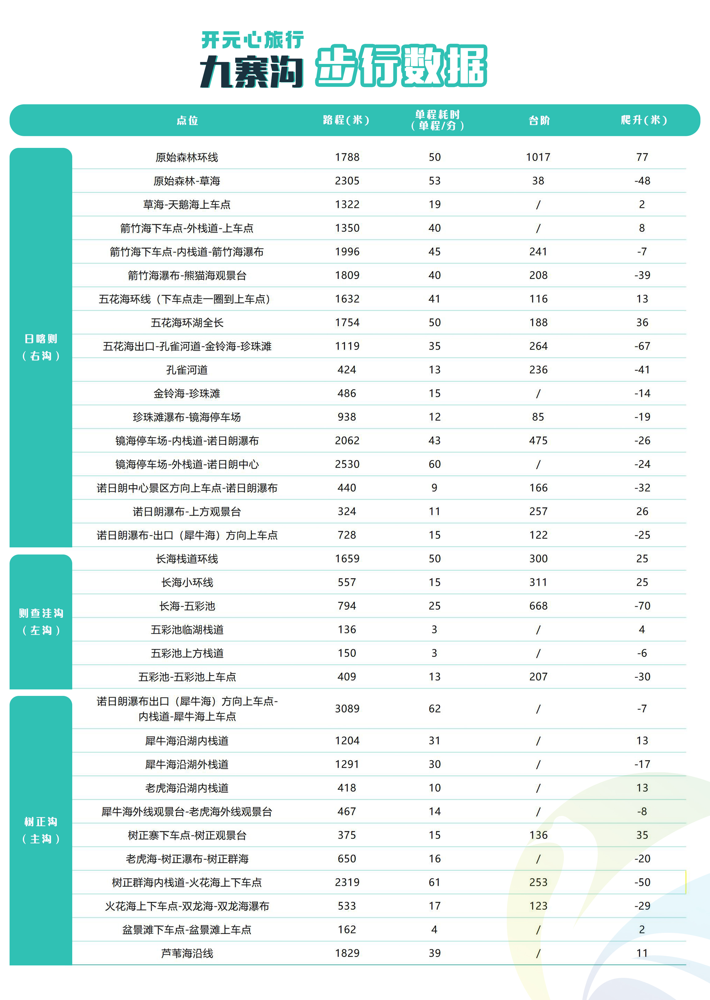

# 九寨沟步行数据

> 来源：图片版《九寨沟步行数据》（`九寨沟步行数据.jpg`）。本文件为文本转写版，原图保留在仓库根目录，便于对照与后续修订。

## 说明

原图标题为「开元心旅行 九寨沟 步行数据」，按沟谷分段（原图左侧三段色块）统计各步行区段的路程（米）、单程耗时（分钟）、台阶与爬升（米）。

- 区段取原图左侧色块：日则沟（右沟）、则查洼沟（左沟）、树正沟（主沟）。
- 原图单元格中的 `/` 表示该项无数据，本表原样保留。
- 爬升一列负数原样保留（表示该段整体以下降为主）。

## 步行数据表

| 区段 | 点位 | 路程（米） | 单程耗时（分钟） | 台阶 | 爬升（米） |
|---|---|---|---|---|---|
| 日则沟（右沟） | 原始森林环线 | 1788 | 50 | 1017 | 77 |
| 日则沟（右沟） | 原始森林-草海 | 2305 | 53 | 38 | -48 |
| 日则沟（右沟） | 草海-天鹅海上车点 | 1322 | 19 | / | 2 |
| 日则沟（右沟） | 箭竹海下车点-外栈道-上车点 | 1350 | 40 | / | 8 |
| 日则沟（右沟） | 箭竹海下车点-内栈道-箭竹海瀑布 | 1996 | 45 | 241 | -7 |
| 日则沟（右沟） | 箭竹海瀑布-熊猫海观景台 | 1809 | 40 | 208 | -39 |
| 日则沟（右沟） | 五花海环线（下车点走一圈到上车点） | 1632 | 41 | 116 | 13 |
| 日则沟（右沟） | 五花海环湖全长 | 1754 | 50 | 188 | 36 |
| 日则沟（右沟） | 五花海出口-孔雀河道-金铃海-珍珠滩 | 1119 | 35 | 264 | -67 |
| 日则沟（右沟） | 孔雀河道 | 424 | 13 | 236 | -41 |
| 日则沟（右沟） | 金铃海-珍珠滩 | 486 | 15 | / | -14 |
| 日则沟（右沟） | 珍珠滩瀑布-镜海停车场 | 938 | 12 | 85 | -19 |
| 日则沟（右沟） | 镜海停车场-内栈道-诺日朗瀑布 | 2062 | 43 | 475 | -26 |
| 日则沟（右沟） | 镜海停车场-外栈道-诺日朗中心 | 2530 | 60 | / | -24 |
| 日则沟（右沟） | 诺日朗中心景区方向上车点-诺日朗瀑布 | 440 | 9 | 166 | -32 |
| 日则沟（右沟） | 诺日朗瀑布-上方观景台 | 324 | 11 | 257 | 26 |
| 日则沟（右沟） | 诺日朗瀑布-出口（犀牛海）方向上车点 | 728 | 15 | 122 | -25 |
| 则查洼沟（左沟） | 长海栈道环线 | 1659 | 50 | 300 | 25 |
| 则查洼沟（左沟） | 长海小环线 | 557 | 15 | 311 | 25 |
| 则查洼沟（左沟） | 长海-五彩池 | 794 | 25 | 668 | -70 |
| 则查洼沟（左沟） | 五彩池临湖栈道 | 136 | 3 | / | 4 |
| 则查洼沟（左沟） | 五彩池上方栈道 | 150 | 3 | / | -6 |
| 则查洼沟（左沟） | 五彩池-五彩池上车点 | 409 | 13 | 207 | -30 |
| 树正沟（主沟） | 诺日朗瀑布出口（犀牛海）方向上车点-内栈道-犀牛海上车点 | 3089 | 62 | / | -7 |
| 树正沟（主沟） | 犀牛海沿湖内栈道 | 1204 | 31 | / | 13 |
| 树正沟（主沟） | 犀牛海沿湖外栈道 | 1291 | 30 | / | -17 |
| 树正沟（主沟） | 老虎海沿湖内栈道 | 418 | 10 | / | 13 |
| 树正沟（主沟） | 犀牛海外线观景台-老虎海外线观景台 | 467 | 14 | / | -8 |
| 树正沟（主沟） | 树正寨下车点-树正观景台 | 375 | 15 | 136 | 35 |
| 树正沟（主沟） | 老虎海-树正瀑布-树正群海 | 650 | 16 | / | -20 |
| 树正沟（主沟） | 树正群海内栈道-火花海上下车点 | 2319 | 61 | 253 | -50 |
| 树正沟（主沟） | 火花海上下车点-双龙海-双龙海瀑布 | 533 | 17 | 123 | -29 |
| 树正沟（主沟） | 盆景滩下车点-盆景滩上车点 | 162 | 4 | / | 2 |
| 树正沟（主沟） | 芦苇海沿线 | 1829 | 39 | / | 11 |

## 转写存疑

- 原图第一段色块文字为「日喀则（右沟）」（中间字放大后可确认为「喀」，带口字旁），与景区沟名「日则沟」不符，疑为原图笔误；本表区段列统一写作「日则沟（右沟）」，在此留痕，便于后续修订时确认。
- 其余文字与数字均逐字核对，无歧义。
